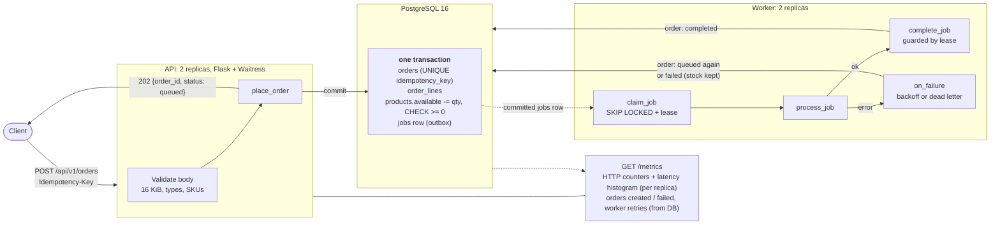
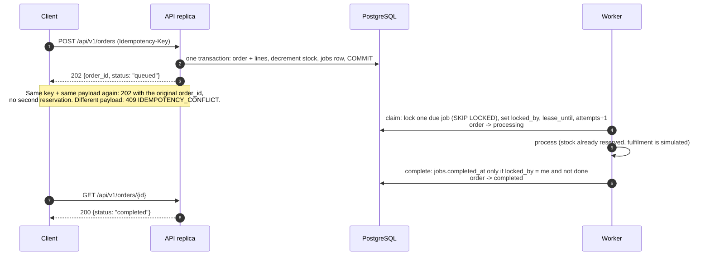
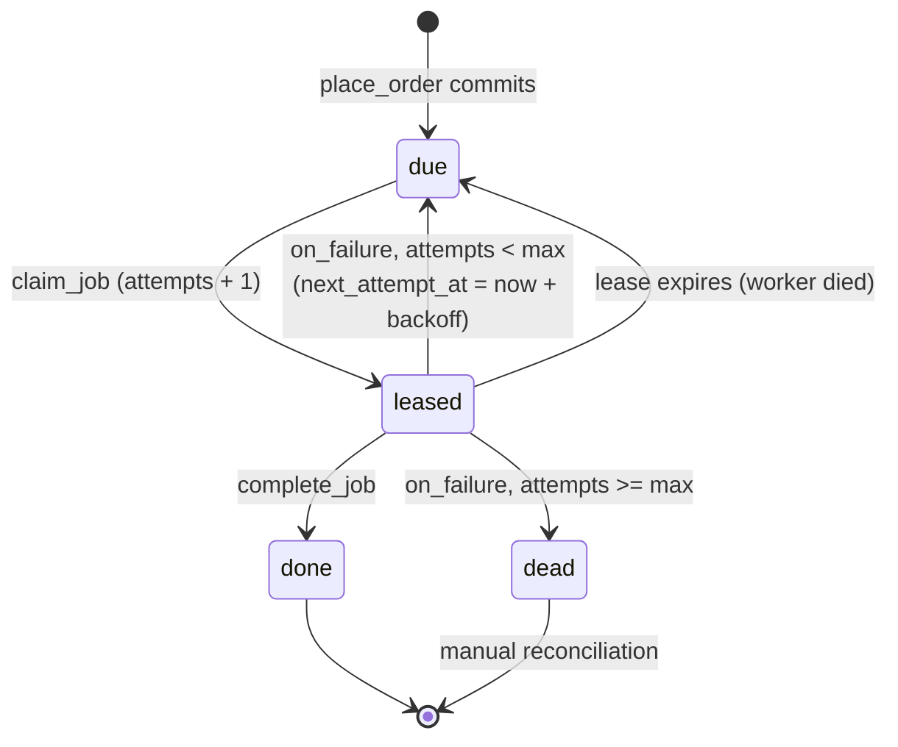
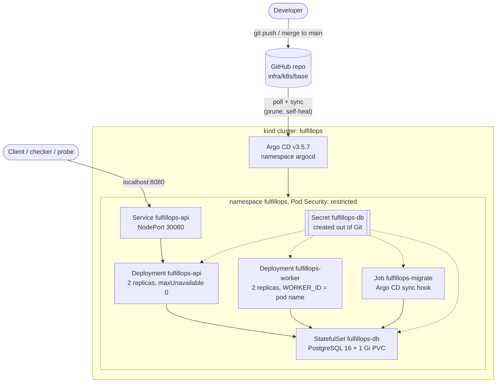

# Architecture

Owner: Mink

FulfillOps accepts orders over HTTP, reserves stock exactly once, and completes orders
asynchronously in a separate worker process. PostgreSQL 16 is the only durable store and also
the work queue: a `jobs` row is the outbox entry for an order. The transaction boundary and
idempotency design are justified in [ADR-001](ADR-001.md); threats are in
[threat-model.md](threat-model.md).

## Data flow

The API responds 202 only after the transaction commits, and it never calls the worker. A worker
only sees an order through its committed `jobs` row, so an order that was acknowledged is
always picked up, and an order that was rolled back never is.

## Order lifecycle

## Job states

There is no status column: a job's state follows from its columns, so every transition is a
single conditional `UPDATE` and two workers can never both "win".

| State | Condition |
|-------|-----------|
| due | `completed_at` and `dead_lettered_at` are NULL, `next_attempt_at <= now()`, no live lease |
| leased | `locked_by` set and `lease_until > now()` |
| done | `completed_at` set |
| dead letter (operator review) | `dead_lettered_at` set; the order is `failed` and keeps its reserved stock |

Backoff is `min(cap, base * 2^(attempts-1))`, with base 1 s and cap 60 s by default. `attempts`
is incremented when a job is claimed, not when it fails, so a job whose workers keep crashing
also hits `max_attempts` (default 5) and is dead-lettered instead of looping forever.

## Invariants and where they are enforced

| Invariant | Enforced by |
|-----------|-------------|
| `available >= 0`, never oversold | `CHECK (available >= 0)` plus the conditional decrement inside the order transaction (ADR-001) |
| One idempotency key maps to at most one order, across replicas | `UNIQUE (idempotency_key)` on `orders`; concurrent losers resolve to the winner's order (ADR-001). No process-local lock or cache |
| An acknowledged order cannot vanish | The order and its `jobs` row commit in the same transaction; a job only leaves the queue by setting `completed_at` or `dead_lettered_at`; an expired lease makes it claimable again |
| Two workers never process the same job at once | `FOR UPDATE SKIP LOCKED` on claim plus a lease; a claimed job is invisible to others until the lease expires |
| An order is never completed twice | `complete_job` updates only `WHERE locked_by = <me> AND completed_at IS NULL AND dead_lettered_at IS NULL`; a worker that lost its lease changes nothing |
| Retries are bounded | `attempts` / `max_attempts` per job, checked on every failure and on every claim |
| Failure never restocks | The worker never writes `products`; a dead-lettered order stays `failed` with stock reserved for manual reconciliation |

### Exactly-once effect on top of at-least-once delivery

Delivery is at-least-once: if a worker dies after claiming a job, the lease expires and another
worker claims it again, so processing can run twice. The business effect still happens once,
because:

- stock is reserved once, at acceptance, in the API transaction, and the worker never touches it;
- the only effect the worker commits is the `completed` transition, which is a conditional
  update owned by the lease holder, so a second run or a stale worker is a no-op;
- processing itself has no external side effect. If it called a real fulfilment service, that
  call would pass `order_id` as its idempotency key so a repeat is ignored downstream.

## Failure behaviour

| Failure | What happens | Recovery |
|---------|--------------|----------|
| API replica dies | Its readiness probe stops passing and the Service routes to the other replica; an in-flight request either committed (and replays idempotently) or rolled back | Kubernetes restarts the pod |
| Worker killed mid-job | The job stays leased until `lease_until` (30 s), then the other worker claims it with `attempts + 1` | Automatic; completes once |
| Worker gets SIGTERM (rollout, scale-down) | It stops claiming, finishes the current job, exits 0 within the 45 s grace period | None needed |
| Database unreachable | API `/health/ready` and worker `/health/ready` return 503, so no new traffic; workers reconnect with backoff (up to 30 s) instead of crashing | Automatic when Postgres returns; data is on the PVC |
| Poison job (fails every time) | Retried with backoff up to `max_attempts`, then dead-lettered; the order becomes `failed`, stock stays reserved, `last_error` is kept | Operator review |
| Broken API release | New pods never become Ready; with `maxUnavailable: 0` the old pods keep serving and the rollout stalls | `git revert`, Argo CD syncs the known-good revision |

## Deployment topology

Argo CD applies objects in waves: the namespace, then Postgres (and waits until it is healthy),
then the migrate Job, then the API and workers. Every pod runs as a non-root user with a
read-only root filesystem, no added capabilities and no service-account token, with CPU and
memory requests and limits. Images are tagged with the commit SHA and loaded with `kind load`;
a release is a Git commit that changes the tag. Operating details are in
[infra/README.md](../infra/README.md).

Locally, `docker compose up -d --build` runs the same processes (two API instances, two
workers, Postgres with a named volume) for development and the fault drills.
